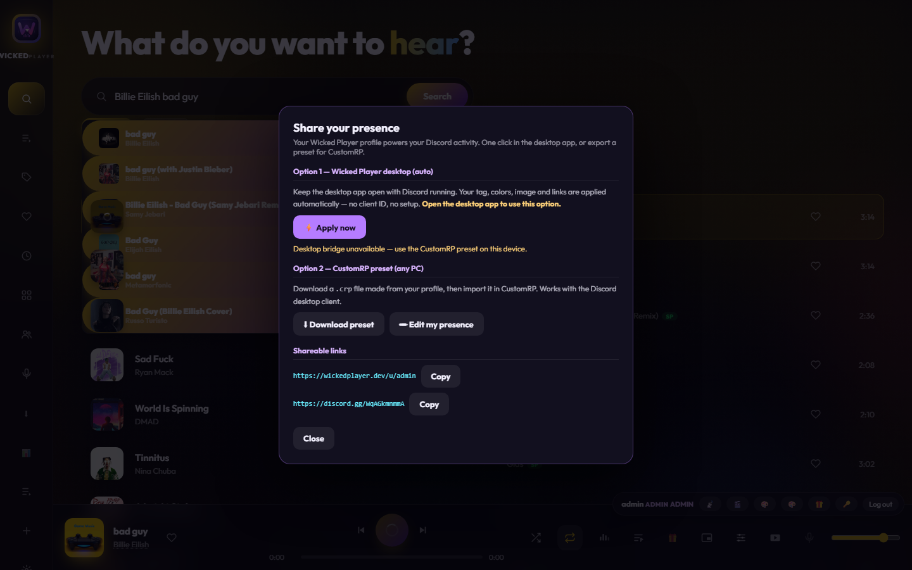

# Wicked Player

Ad-free music player with effects, lyrics, overlays, community profiles and Discord Rich Presence.

## Download / Update

**Latest release (v3.5.13):** https://github.com/Tone730/wicked-player/releases/latest

Direct installer: https://github.com/Tone730/wicked-player/releases/latest/download/Wicked-Player-Setup-3.5.13.exe

Install once and the app auto-updates from GitHub (`latest.yml`). Existing installs from 3.5.0 onward pick up new releases automatically.

## Screenshots

### Search and player


### Now playing


### Discord presence settings



## What's in v3.5.13

- **Reliable full-track playback** — the newest selection preempts stale resolver work, preview endings no longer skip the queue, and full streams resume at the correct position.
- **Accurate genre cards** — all 40 genre cards use a dedicated, genre-constrained catalog route instead of generic keyword results.
- **Faster search and playback** — bounded search, serialized yt-dlp resolution, immediate provider previews and cached full-resolution upgrades reduce stalls.
- **Reliable track matching** — fallback playback rejects fuzzy matches from a different artist and resolves only the selected track.
- **Cleaner error reporting** — playback failures and rate limits are reported accurately without misleading “Saved” or “Save failed (502)” popups.
- **Safe preview caching** — short provider previews never block a later full-resolution stream, and legacy preview entries are removed on upgrade.
- **Hosted mode** — the desktop app connects straight to `https://wickedplayer.dev`. No local server, cookies, VPN or proxy setup is needed; playback fixes run server-side.
- Updated Electron runtime and build dependencies for a safer, current desktop app.

## Repository layout

- `electron/` — Electron desktop app, electron-builder config and release publisher.
- `wicked-frontend/dist/` — authoritative compiled web UI and playback-policy assets shipped in the installer (including asset bundle `index-2kADS7Vh-p4.js`).
- `wicked-backend/` — source for the hosted server deployed at `wickedplayer.dev`.
- `docs/screenshots/` — real screenshots used on this page.

## Building the desktop app

```powershell
cd electron
npm install
npx electron-builder -w
```

The installer is written to `electron/dist/`. `release.ps1 -Bump` builds, publishes a GitHub release and uploads the installer, blockmap and `latest.yml`.

Security note: the installer deliberately bundles **no** backend code and **no** `.env`. Only `discord-app.json` (public client ID + invite) is included. Do not add credentials to `electron/` or to `electron-builder.yml`.

## Running the hosted backend

The backend in `wicked-backend/` is deployed on the server. It requires a private `.env` (never committed) with `PORT`, `ADMIN_USER`, `ADMIN_PASS`, `ADMIN_KEY`, `ALLOW_REGISTRATION` and the Discord/Spotify OAuth settings. Start it with `node server.js`.

## Support

Report issues at https://github.com/Tone730/wicked-player/issues.
